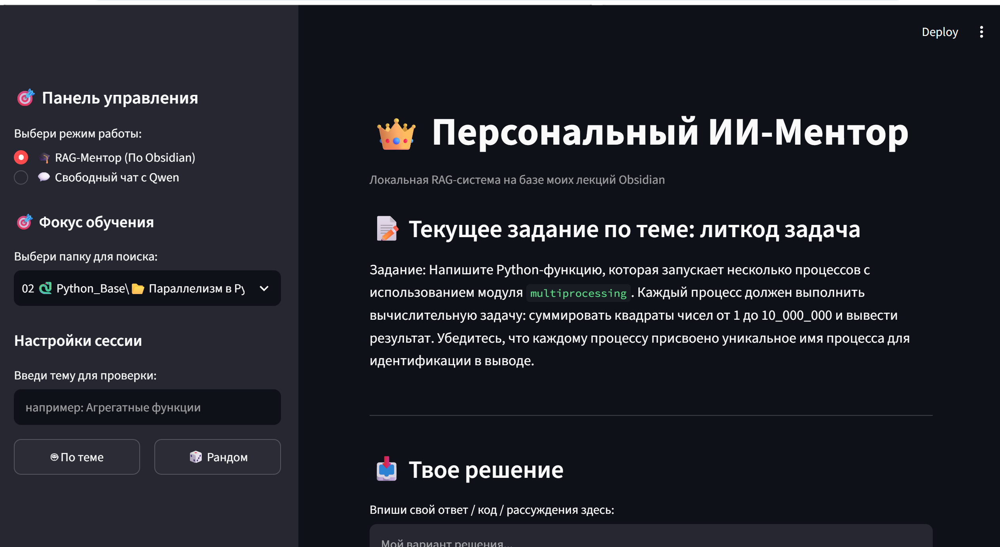

# Local RAG Mentor with Ollama & Qwen 2.5

Интеллектуальная локальная RAG-система (Retrieval-Augmented Generation) и персональный ИИ-ментор на базе базы знаний лекций Obsidian.

## Архитектура и интерфейс системы


## Технический стек и особенности архитектуры
* **Интерфейс:** Streamlit (сессионное кэширование ресурсов, кастомный рендеринг LaTeX-формул).
* **Локальная LLM:** Qwen 2.5:7b, запущенная и оптимизированная локально через Ollama.
* **Векторный индекс (RAG):** Глубокое сканирование и извлечение релевантного контекста из лекционных маркдаун-файлов (.md) Obsidian с помощью LangChain Chroma и мультиязычных эмбеддингов HuggingFace (`paraphrase-multilingual-MiniLM-L12-v2`).
* **Бизнес-логика:** 
  * Двухрежимная система (свободный чат с моделью и изолированный RAG-ментор).
  * Вероятностный стохастический выбор случайных тем для проверки знаний (`random.choice`).
  * Жесткая изоляция SQL/Python кода от студента (автоматический анти-спойлер фильтр в промпт-инжиниринге).
  * Беспристрастная верификация ответов по материалам конспектов с выводом чек-листа усвоения темы.

## Локальный запуск
1. Установите необходимые библиотеки:
   ```bash
   pip install -r requirements.txt
   ```
2. Убедитесь, что Ollama запущена локально в фоновом режиме:
   ```bash
   ollama run qwen2.5:7b
   ```
3. В файле `app.py` укажите путь к вашему локальному хранилищу заметок в переменной `OBSIDIAN_VAULT`.
4. Запустите веб-интерфейс:
   ```bash
   streamlit run app.py
   ```
